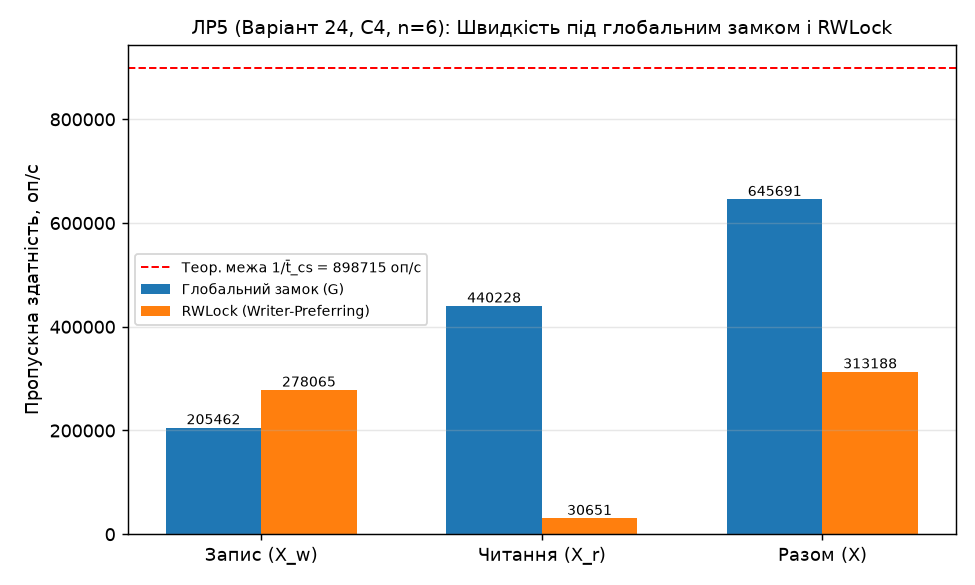
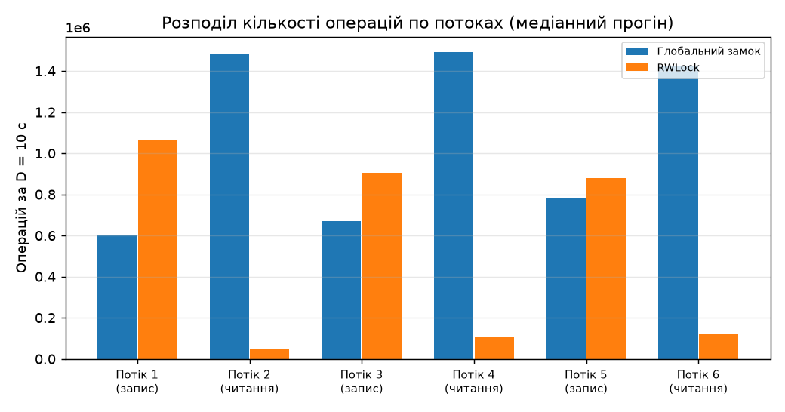
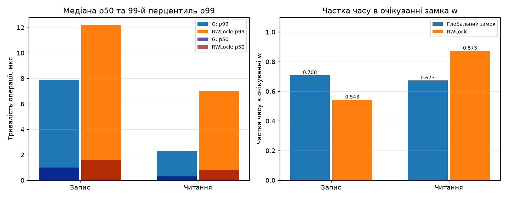

# Звіт з лабораторної роботи №5
## Проєктування потокобезпечної структури даних

- **Варіант:** 24
- **Структура даних:** **С4** — обмежена пріоритетна черга місткістю `256` (max-heap на базі масиву)
- **Кількість потоків стенду:** $n = 6$ ($n_w = \lceil 6 / 2 \rceil = 3$ потоки запису з номерами `1, 3, 5`; $n_r = \lfloor 6 / 2 \rfloor = 3$ потоки читання з номерами `2, 4, 6`)
- **Операції запису:** `push(p, x)`, за яким той самий потік виконує `pop()`, щоб черга не переповнювалася і не порожніла
- **Операції читання:** `peek_max()` і `size()` порівну (`50 / 50`)
- **Тривалість вимірювання:** $D = 10\text{ с}$ після `1 с` прогріву, по `3` повтори на режим із взяттям медіани

---

## 1. Опис структури даних та політики синхронізації (крок 1)

### 1.1. Структура **С4** (`BoundedPriorityQueue`, файл [`sync_pq.py`](sync_pq.py))

Черга реалізована вручну без готових потокобезпечних колекцій мови (`queue.Queue`, `queue.PriorityQueue`) як бінарна max-купина (`_heap: list[tuple[int, int, int]]`) обмеженої місткості `capacity = 256`. Кожен елемент містить `(priority, seq_tiebreaker, item_id)`, де:
- `push(priority, item_id)` під захистом запису додає елемент у кінець масиву та відновлює властивість купини просіюванням угору (`_sift_up`);
- `pop()` під захистом запису вилучає кореневий (максимальний за пріоритетом) елемент, переміщуючи останній елемент у корінь і просіюючи його вниз (`_sift_down`);
- `peek_max()` та `size()` виконуються під захистом читання без будь-яких змін полів структури (`_heap`, `_seq`, `min_size_seen`, `max_size_seen`).

Перед початком кожного прогону черга заповнюється `128` початковими елементами (`capacity / 2`), а оскільки кожен з 3 потоків запису чергує `push` і `pop`, розмір черги протягом усього вимірювання гарантовано залишається в межах `[128, 131] ⊂ [0, 256]`. Жодних умовних змінних для очікування порожньої чи повної черги в самій структурі не використовується.

### 1.2. Політика замка читання-запису (`WriterPreferringRWLock`)

Замок читання-запису [`WriterPreferringRWLock`](sync_pq.py#L9-L43) побудований на одній умовній змінній `threading.Condition(threading.Lock())` із політикою **пріоритету запису (Writer-Preferring)**:
- стани замка задаються лічильниками `_readers` (активні читачі), `_writer_active` (чи триває запис) та `_writers_waiting` (кількість писців, що чекають на вхід);
- операція `acquire_read()` допускає паралельний вхід читача лише тоді, коли `_writer_active == False` **і** `_writers_waiting == 0`; в іншому разі читач переходить у `wait()`;
- операція `acquire_write()` негайно збільшує `_writers_waiting += 1`, очікує завершення поточного запису та виходу всіх поточних читачів (`_readers == 0`), після чого активує запис (`_writer_active = True`) і зменшує `_writers_waiting -= 1`;
- при звільненні (`release_read()` при досягненні `_readers == 0` та `release_write()`) викликається `notify_all()`.

Перевага політики `Writer-Preferring` полягає в унеможливленні голодування писців (writer starvation), проте за безперервного потоку записів від `n_w = 3` потоків (`_writers_waiting > 0` майже постійно) потоки читання вимушено пропускають писців уперед.

### 1.3. Стенд та перевірка інваріантів (`bench_lab5.py`)

### Таблиця 1. Характеристики стенду та результати перевірки інваріантів

| $n$ | $n_w$ | $n_r$ | Мова і версія | Логічних ядер | $X_1$, оп/с | Інваріанти після прогонів кроків 2 і 3 |
|---|---|---|---|---|---|---|
| 6 | 3 | 3 | Python `3.14.5` | 12 | `554 952.40` (Global) / `332 234.80` (RWLock) | **PASS** (усі 6 прогонів: `len ∈ [128, 131] ⊆ [0, 256]`, властивість max-heap збережена, кожен покладений `item_id` вийнято рівно один раз — до `1 602 413` елементів без дублів і втрат, операції читання не змінюють полів структури) |

---

## 2. Результати вимірювань для глобального замка та RWLock (кроки 2–3)

Тривалості операцій ($\tau = t_{\text{ret}} - t_{\text{call}}$), час очікування замка ($t_{\text{wait}} = t_{\text{acq}} - t_{\text{call}}$) і тривалість критичної секції ($t_{\text{cs}} = t_{\text{rel}} - t_{\text{acq}}$) виміряні за допомогою `time.perf_counter_ns()`. У таблицях наведено медіани за 3 повторами тривалістю $D = 10\text{ с}$.

### Таблиця 2. Глобальний замок (`threading.Lock`)

| Роль | Операцій за $D = 10\text{ с}$ | $X$, оп/с | $p_{50}$, мкс | $p_{99}$, мкс | Найбільший $t_{\text{wait}}$, мс | $w$ | $\text{cv}$ | $t_{\text{cs}}$, мкс |
|---|---|---|---|---|---|---|---|---|
| Запис (`push`/`pop`) | 2 054 625 | **205 462.50** | 1.00 | 7.90 | 216.785 | 0.7082 | 0.1078 | 2.0236 |
| Читання (`peek_max`/`size`) | 4 402 284 | **440 228.40** | 0.30 | 2.30 | 172.113 | 0.6728 | 0.1064 | 0.2018 |
| Разом | 6 456 909 | **645 690.90** | 0.30 | 5.00 | 216.785 | 0.6850 | 0.3673 | **1.1127** |

**Розрахунок межі пропускної здатності під глобальним замком:**
$$\bar{t}_{\text{cs}} = \frac{n_w \cdot t_{\text{cs, w}} + n_r \cdot t_{\text{cs, r}}}{n} = \frac{3 \cdot 2.0236 + 3 \cdot 0.2018}{6} = \mathbf{1.1127\text{ мкс}}$$
$$\frac{1}{\bar{t}_{\text{cs}}} = \frac{1}{1.1127 \cdot 10^{-6}\text{ с}} = \mathbf{898\,714.84\text{ оп/с}}$$

### Таблиця 3. RWLock (`WriterPreferringRWLock` на `threading.Condition`)

| Роль | Операцій за $D = 10\text{ с}$ | $X$, оп/с | $p_{50}$, мкс | $p_{99}$, мкс | Найбільший $t_{\text{wait}}$, мс | $w$ | $\text{cv}$ |
|---|---|---|---|---|---|---|---|
| Запис (`push`/`pop`) | 2 780 646 | **278 064.60** | 1.60 | 12.20 | 342.066 | 0.5426 | 0.0869 |
| Читання (`peek_max`/`size`) | 306 506 | **30 650.60** | 0.80 | 7.00 | 2568.115 | 0.8732 | 0.3531 |
| Разом | 3 131 884 | **313 188.40** | 1.60 | 12.00 | 2568.115 | 0.7052 | 0.8164 |

### Таблиця 4. Кількість операцій потоків за $D = 10\text{ с}$ (медіанний прогін)

| Потік | Роль | Глобальний замок | RWLock |
|---|---|---|---|
| 1 | запис | 603 315 | 1 066 773 |
| 2 | читання | 1 483 053 | 47 811 |
| 3 | запис | 669 163 | 906 144 |
| 4 | читання | 1 492 686 | 106 384 |
| 5 | запис | 782 147 | 879 888 |
| 6 | читання | 1 426 545 | 124 884 |

---

## 3. Метрики прискорення та завантаженість глобального замка (крок 4)

### Таблиця 5. Метрики прискорення (`results/analysis/tables.md`)

| Метрика | Формула | Значення |
|---|---|---|
| $S(n)$, глобальний замок | $X(G) / X_1(G) = 645690.90 / 554952.40$ | **1.1635** |
| $E(n)$, глобальний замок | $S(n) / n = 1.1635 / 6$ | **0.1939** |
| $S(n)$, RWLock | $X(RW) / X_1(RW) = 313188.40 / 332234.80$ | **0.9427** |
| $E(n)$, RWLock | $S(n) / n = 0.9427 / 6$ | **0.1571** |
| $S_w$ | $X_w(RW) / X_w(G) = 278064.60 / 205462.50$ | **1.3534** |
| $S_r$ | $X_r(RW) / X_r(G) = 30650.60 / 440228.40$ | **0.0696** |
| $S_\Sigma$ | $X(RW) / X(G) = 313188.40 / 645690.90$ | **0.4850** |
| $\rho$, завантаженість глобального замка | $X(G) \cdot \bar{t}_{\text{cs}} = 645690.90 \cdot 1.1127 \cdot 10^{-6}$ | **0.7185** |

**Порівняння $X(G)$ з теоретичною межею $1 / \bar{t}_{\text{cs}}$:**
Сумарна пропускна здатність під глобальним замком становить **$X(G) = 645\,690.90\text{ оп/с}$**, що дорівнює **$71.85\ \%$** ($\rho = 0.7185$) від теоретичної межі пропускної здатності замка $1 / \bar{t}_{\text{cs}} = 898\,714.84\text{ оп/с}$. Решта `28.15 %` часу витрачається на накладні витрати захоплення й звільнення `threading.Lock`, перемикання контексту Python GIL між 6 потоками та виконання двох викликів `time.perf_counter_ns()` поза замком на кожну операцію. Завантаженість замка $\rho = 0.7185$ разом із часткою очікування $w = 0.6850$ означає, що глобальний замок працює поблизу насичення і вже 6 потоків не дають лінійного прискорення ($S(6) = 1.1635$, ефективність $E(6) = 0.1939$).

---

## 4. Порівняння доступу до даних для потоків запису й читання (крок 5)

### Таблиця 6. Порівняння доступу до даних (`G` — глобальний замок, `RW` — RWLock)

| Показник | G: запис | G: читання | RW: запис | RW: читання | RW / G: запис | RW / G: читання |
|---|---|---|---|---|---|---|
| $X$, оп/с | 205 462.50 | 440 228.40 | 278 064.60 | 30 650.60 | **1.3534** | **0.0696** |
| $x$, на один потік ролі, оп/с | 68 487.50 | 146 742.80 | 92 688.20 | 10 216.87 | **1.3534** | **0.0696** |
| $p_{50}$, мкс | 1.00 | 0.30 | 1.60 | 0.80 | **1.6000** | **2.6667** |
| $p_{99}$, мкс | 7.90 | 2.30 | 12.20 | 7.00 | **1.5443** | **3.0435** |
| $h = p_{99} / p_{50}$ | 7.90 | 7.67 | 7.62 | 8.75 | **0.9652** | **1.1413** |
| Найбільший $t_{\text{wait}}$, мс | 216.785 | 172.113 | 342.066 | 2568.115 | **1.5779** | **14.9211** |
| $w$ | 0.7082 | 0.6728 | 0.5426 | 0.8732 | **0.7663** | **1.2980** |
| $\text{cv}$ | 0.1078 | 0.1064 | 0.0869 | 0.3531 | **0.8056** | **3.3196** |
| $\varphi$, частка ролі в усіх операціях | 0.3182 | 0.6818 | 0.9007 | 0.0993 | **2.8306** | **0.1456** |

### Аналіз змін доступу до даних за таблицею 6

1. **Для ролі запису (`RW / G: запис`):** зміна глобального замка на `WriterPreferringRWLock` **збільшила швидкість доступу на `+35.3 %`** ($S_w = 1.3534$: з `205 462.5` до `278 064.6` оп/с). Головна причина видно з поля **`w`** (частка часу очікування зменшилася з `0.7082` до **`0.5426`**, відношення `0.7663`) та **`cv`** (рівномірність між писцями покращилася з `0.1078` до **`0.0869`**). При цьому медіанна тривалість самого виклику $p_{50}$ дещо зросла (`1.00 -> 1.60` мкс), оскільки навіть для неконкурентного захоплення запису у Python доводиться двічі входити у внутрішній `Condition` і робити `notify_all()`.
2. **Для ролі читання (`RW / G: читання`):** зміна на `RWLock` **зменшила швидкість читання у `14.4` раза** ($S_r = 0.0696$: з `440 228.4` до `30 650.6` оп/с, а частка читань у потоці $\varphi_r$ обвалилася з `68.18 %` до `9.93 %`). За таблицею 6 це безпосередньо проявляється в усіх трьох показниках конкуренції читачів:
   - **частка очікування $w$** зросла з `0.6728` до **`0.8732`** (`+29.8 %` робочого часу потоків витрачено на сон у `Condition.wait()`);
   - **найбільший $t_{\text{wait}}$** зріс у **`14.92` раза** — зі `172.11 мс` до **`2568.12 мс`** (понад чверть усього 10-секундного прогону окремий читач чекав у черзі, поки 3 безперервні потоки запису не звільнили `_writers_waiting`), а хвіст тривалості $p_{99}$ збільшився в **`3.04` раза** (`2.30 -> 7.00` мкс, $h$ зросло з `7.67` до `8.75`);
   - **коефіцієнт варіації $\text{cv}$** між трьома читачами зріс у **`3.32` раза** (`0.1064 -> 0.3531`: у медіанному прогоні потік 2 встиг виконати `47 811` читань, а потік 6 — `124 884`, тобто в `2.61` раза більше через нерівномірність пробудження з `Condition.wait()` під час коротких вікон, коли `_writers_waiting == 0`).

**Головний висновок до ЛР5:**
У Python на коротких критичних секціях в оперативній памʼяті ($t_{\text{cs, r}} = 0.20\text{ мкс}$, $t_{\text{cs, w}} = 2.02\text{ мкс}$) заміна нативного C-примітива `threading.Lock` на програмний `RWLock` поверх `threading.Condition` є контрпродуктивною для сумарної пропускної здатності ($S_\Sigma = 0.4850$). По-перше, сама реалізація `RWLock` на Python-коді всередині `Condition` має внутрішні витрати більші, ніж час читання вершини купини (`peek_max`/`size` за `0.2 мкс`), що видно вже на 1 потоці ($X_1(RW) = 332\,235 < X_1(G) = 554\,952\text{ оп/с}$). По-друге, в CPython `GIL` усе одно серіалізує виконання байткоду між потоками, тому одночасне читання без блокування на рівні Python-потоків не дає паралельного прискорення CPU, а політика `Writer-Preferring` за інтенсивного запису витісняє читачів у тривале очікування ($t_{\text{wait, max}} = 2.57\text{ с}$). Застосування `RWLock` виправдане лише тоді, коли операції читання тривалі (від десятків мікросекунд чи з I/O, що звільняє GIL), або в нативних мовах (Go/Rust) без глобального інтерпретатора, коли $t_{\text{cs, r}} \gg t_{\text{lock\_overhead}}$.
